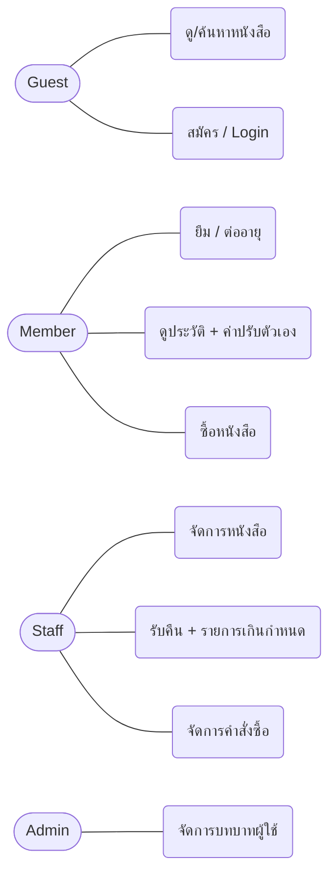
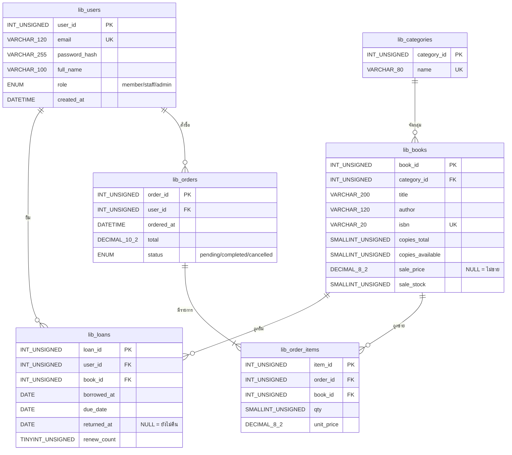

# Milestone 1 — Book Lending Shop · ร้านยืมหนังสือ

ระบบยืม-คืนและร้านขายหนังสือ | GitHub: https://github.com/68160053-hash/library-lending-system | ต้นแบบหน้าเว็บ: https://68160053-hash.github.io/library-lending-system/prototype/index.html

สถานะ: ร่าง (ข้อที่ไม่แน่ใจมีป้าย **[ยังไม่ยืนยัน]**)

## 1. ปัญหา กลุ่มผู้ใช้ และทางแก้

**Problem statement:** ห้องสมุด/ชั้นหนังสือของมหาวิทยาลัยขนาดเล็กยังจดการยืม-คืนด้วยสมุดหรือ Excel ทำให้ไม่รู้ว่าเล่มไหนว่าง ใครถืออยู่ และใครเกินกำหนด ระบบนี้เก็บข้อมูลไว้ที่เดียวและคำนวณวันครบกำหนดกับค่าปรับให้อัตโนมัติ

**กลุ่มผู้ใช้:**
| บทบาท | คือใคร |
|---|---|
| member | นักศึกษา/บุคลากรที่ยืมหรือซื้อหนังสือ |
| staff | เจ้าหน้าที่ที่จัดการหนังสือและรับคืน |
| admin | ผู้ดูแลระบบ (ทำแทน staff ได้ + จัดการบทบาทผู้ใช้) |

**Pain point (ตัวอย่างของเดิม):** นักศึกษายืม "Database System Concepts" ไป เจ้าหน้าที่จดชื่อลงสมุด 7 วันต่อมาไม่มีใครเปิดสมุดดู เล่มเกินกำหนดไป 12 วัน คนอื่นมาถามหาก็ไม่รู้ว่าเล่มอยู่ที่ใคร และค่าปรับต้องนับวันด้วยมือซึ่งนับผิดบ่อย

**ทางแก้:** เว็บ PHP + MySQL ที่ยืม/คืน/ต่ออายุผ่านระบบ แสดงรายการเกินกำหนดและค่าปรับทันที สมาชิกเห็นประวัติของตัวเอง

**กฎธุรกิจที่ตัดสินใจแล้ว:** ยืมฟรี 7 วัน ต่ออายุได้ 1 ครั้ง (+7 วัน และต่อไม่ได้ถ้าเกินกำหนดแล้ว) คืนช้าปรับ 5 บาท/วัน (คำนวณตอนแสดงผล ไม่เก็บในตาราง ไม่มีการจ่ายออนไลน์) สมาชิกกดยืมเอง ส่วนการรับคืน staff เป็นคนบันทึก

## 2. ขอบเขตฟีเจอร์

| ฟีเจอร์ | ระดับ | ทำได้จริงภายใน 10 พ.ย.? |
|---|---|---|
| Login / Logout / สมัครสมาชิก | Must | ✅ (หน้าหลักเขียนแล้ว 27 ต.ค.) |
| CRUD หนังสือ + หมวด (staff) | Must | ✅ |
| ยืม / รับคืน / ต่ออายุ | Must | ✅ (ต่ออายุ/ประวัติเขียนแล้ว) |
| รายการเกินกำหนด + ค่าปรับ | Must | ✅ (หน้าเขียนแล้ว) |
| สมาชิกดูประวัติของตัวเอง | Must | ✅ (หน้าเขียนแล้ว) |
| ซื้อหนังสือ + ประวัติคำสั่งซื้อ | Nice | ⚠️ เริ่มเมื่อแกนหลักเสร็จ (ตัดสินใจ 4 พ.ย.) |
| ค้นหาหนังสือ | Nice | ✅ (แค่ `LIKE`) |
| จัดการบทบาทผู้ใช้ (admin) | Nice | ⚠️ |
| จำกัดจำนวนเล่มที่ยืม, ชำระเงินออนไลน์, ส่งอีเมลเตือน, แยกเลขเล่มรายเล่ม, ใบเสร็จ PDF | Out of scope | ❌ |

## 3. Use case

| บทบาท | Use case |
|---|---|
| Guest | ดูรายการหนังสือ, ค้นหา, สมัครสมาชิก, login |
| Member | logout, ยืม, ต่ออายุ, ดูประวัติและค่าปรับของตัวเอง, ซื้อหนังสือ, ดูคำสั่งซื้อของตัวเอง |
| Staff | เพิ่ม/แก้/ลบหนังสือและหมวด, รับคืน, ดูรายการเกินกำหนด, จัดการสถานะคำสั่งซื้อ |
| Admin | ทุกอย่างของ staff + เปลี่ยนบทบาทผู้ใช้ |


(ไดอะแกรมนี้เป็นร่างจาก flowchart เพราะ Mermaid ไม่มี use case diagram โดยตรง ตอนส่งจริงควรวาดใหม่ใน draw.io)

## 4. ER diagram (ร่าง)



| ตาราง | ทำไมต้องมี |
|---|---|
| lib_users | เก็บบัญชีและบทบาท ใช้ทั้ง login และ authorization |
| lib_categories | จัดหมวดหนังสือ ไม่ต้องพิมพ์ชื่อหมวดซ้ำ |
| lib_books | รายการหนังสือ + จำนวนเล่มให้ยืม + ราคา/สต็อกขาย |
| lib_loans | หนึ่งแถวต่อการยืมหนึ่งครั้ง ใช้ติดตามเกินกำหนดและประวัติ |
| lib_orders | หัวคำสั่งซื้อ (ใคร เมื่อไร ยอดรวม สถานะ) |
| lib_order_items | รายการในคำสั่งซื้อ เก็บราคาตอนซื้อไว้ |
| lib_attempts | (เพิ่มภายหลัง) ตารางช่วยด้านความปลอดภัย เก็บการล็อกอินผิด/การสมัครเพื่อจำกัดจำนวนครั้ง ไม่มี FK และไม่อยู่ใน ER ของโดเมน (ER ยังเป็น 6 ตารางหลัก) |

## 5. Data dictionary

**lib_users**
| คอลัมน์ | ชนิด | Key | Null | คำอธิบาย |
|---|---|---|---|---|
| user_id | INT UNSIGNED | PK | No | รหัสผู้ใช้ (auto) |
| email | VARCHAR(120) | UNIQUE | No | ใช้ login ห้ามซ้ำ |
| password_hash | VARCHAR(255) | | No | bcrypt จาก `password_hash` |
| full_name | VARCHAR(100) | | No | ชื่อ |
| role | ENUM | | No | member / staff / admin (ค่าเริ่ม member) |
| created_at | DATETIME | | No | วันที่สมัคร |

**lib_categories**
| คอลัมน์ | ชนิด | Key | Null | คำอธิบาย |
|---|---|---|---|---|
| category_id | INT UNSIGNED | PK | No | รหัสหมวด |
| name | VARCHAR(80) | UNIQUE | No | ชื่อหมวด |

**lib_books**
| คอลัมน์ | ชนิด | Key | Null | คำอธิบาย |
|---|---|---|---|---|
| book_id | INT UNSIGNED | PK | No | รหัสหนังสือ |
| category_id | INT UNSIGNED | FK→lib_categories | No | หมวด |
| title | VARCHAR(200) | | No | ชื่อเรื่อง |
| author | VARCHAR(120) | | No | ผู้แต่ง |
| isbn | VARCHAR(20) | UNIQUE | No | ISBN |
| copies_total | SMALLINT UNSIGNED | | No | จำนวนเล่มทั้งหมด (ค่าเริ่ม 1) |
| copies_available | SMALLINT UNSIGNED | | No | เล่มที่ว่างให้ยืม (ค่าเริ่ม 1; CHECK ต้อง ≤ copies_total) |
| sale_price | DECIMAL(8,2) | | Yes | ราคาขาย (NULL = ไม่ขาย) |
| sale_stock | SMALLINT UNSIGNED | | No | จำนวนที่ขายได้ (ค่าเริ่ม 0) |

**lib_loans**
| คอลัมน์ | ชนิด | Key | Null | คำอธิบาย |
|---|---|---|---|---|
| loan_id | INT UNSIGNED | PK | No | รหัสการยืม |
| user_id | INT UNSIGNED | FK→lib_users | No | ผู้ยืม (ใช้เป็น owner id ใน WHERE) |
| book_id | INT UNSIGNED | FK→lib_books | No | หนังสือที่ยืม |
| borrowed_at | DATE | | No | วันยืม |
| due_date | DATE | | No | วันครบกำหนด (ยืม+7, ต่อ +7) |
| returned_at | DATE | | Yes | วันคืน (NULL = ยังไม่คืน) |
| renew_count | TINYINT UNSIGNED | | No | จำนวนครั้งที่ต่อ (ค่าเริ่ม 0, สูงสุด 1 ตามกฎ — บังคับในโค้ด PHP) |

ค่าปรับ = `GREATEST(0, DATEDIFF(IFNULL(returned_at, CURDATE()), due_date)) * 5` ไม่เก็บในตาราง

**lib_orders**
| คอลัมน์ | ชนิด | Key | Null | คำอธิบาย |
|---|---|---|---|---|
| order_id | INT UNSIGNED | PK | No | รหัสคำสั่งซื้อ |
| user_id | INT UNSIGNED | FK→lib_users | No | ผู้ซื้อ (owner id) |
| ordered_at | DATETIME | | No | เวลาสั่ง |
| total | DECIMAL(10,2) | | No | ยอดรวม (ค่าเริ่ม 0) |
| status | ENUM | | No | pending / completed / cancelled (ค่าเริ่ม pending) |

**lib_order_items**
| คอลัมน์ | ชนิด | Key | Null | คำอธิบาย |
|---|---|---|---|---|
| item_id | INT UNSIGNED | PK | No | รหัสรายการ |
| order_id | INT UNSIGNED | FK→lib_orders | No | คำสั่งซื้อ |
| book_id | INT UNSIGNED | FK→lib_books | No | หนังสือ |
| qty | SMALLINT UNSIGNED | | No | จำนวน (ค่าเริ่ม 1) |
| unit_price | DECIMAL(8,2) | | No | ราคา ณ ตอนซื้อ |

กฎ FK: ทุก FK เป็น `ON DELETE RESTRICT` (ลบหมวด/ผู้ใช้/หนังสือที่ยังมีข้อมูลอ้างอิงไม่ได้) ยกเว้น `lib_order_items.order_id` เป็น `CASCADE` (ลบคำสั่งซื้อแล้วลบรายการตาม)

SQL สร้างตาราง: `sql/schema.sql` (หมวดตัวอย่าง: นิยายแฟนตาซี, วิทยาศาสตร์, ประวัติศาสตร์, วรรณกรรมคลาสสิก, คอมพิวเตอร์) **[ยังไม่ยืนยัน]** เวอร์ชัน MySQL บน Angsila — `CHECK` บังคับใช้ตั้งแต่ MySQL 8.0.16

## 6. แผนงานรายวัน (27 ต.ค. – 10 พ.ย.)

**การแบ่งงาน:**
| คน | หน้าที่ |
|---|---|
| P1 · 68160053 วัณณุวรรธน์ | หน้าเว็บ + UI/VFX (`includes/header.php`, `footer.php`, `assets/` CSS/JS, เลย์เอาต์ทุกหน้า) + ความปลอดภัย (`includes/auth.php`, CSRF, ตรวจสิทธิ์) + repo/deploy + ประสานงาน |
| A · 68160203 ภัทรพล | ฐานข้อมูล (ER, schema, `config/db.php`) + CRUD หนังสือ |
| B · 68160382 เตชินท์ | ตรรกะยืม/คืน/ต่ออายุ/ค่าปรับ + ร้านขาย |

| วัน | งาน | ผู้รับผิดชอบ (ข้อสมมติ 3 คน) |
|---|---|---|
| 27 ต.ค. | **เสร็จแล้ว:** repo + `.gitignore`, เอกสาร, `sql/schema.sql`, ต้นแบบ UI (3 รอบ), หน้า register/login/logout/my-loans/renew/overdue (ความปลอดภัยทำก่อนกำหนด) | P1 |
| 28 | ตรวจ ER + data dictionary ให้ตรง schema; วาด use case diagram ใน draw.io | P1 / A |
| 29 | **schema สุดท้ายต้องนิ่ง** (A ทดสอบ import บน MySQL จริง); ตกลงชื่อไฟล์/ฟังก์ชันที่ B ใช้ | A / B |
| 30 | รวม proposal + เช็กลิสต์ Milestone 1; README ให้ครบ | P1 |
| 31 | **ส่ง Milestone 1** | P1 |
| 1 พ.ย. | CRUD หนังสือ + หมวด (staff); หน้ายืมหนังสือ | A / B |
| 2 | หน้ารับคืน (staff) เชื่อมกับ my-loans/renew/overdue ที่มีแล้ว; ตรวจสิทธิ์ทุกหน้า | B / P1 |
| 3 | ค้นหา; ทดสอบกรณีขอบ (ต่ออายุตอนเกินกำหนด, ยืมเล่มที่หมด, แก้ id ของคนอื่นใน URL) | B / A |
| 4 | **ตัดสินใจเรื่องร้านขาย** (แกนหลักต้องเสร็จก่อน); ถ้าไม่ทัน ตัดออก | ทุกคน |
| 5-6 | ร้านขาย + คำสั่งซื้อ (ถ้าทำ); security review ทุก query | B / P1 |
| 7 | deploy ขึ้น Angsila; ทดสอบบนเครื่องจริง | P1 |
| 8 | แก้บั๊ก; ถ่าย screenshot; ร่างรายงาน | ทุกคน |
| 9 | รายงานฉบับเต็ม + README + ตารางผลทดสอบ | ทุกคน |
| 10 พ.ย. | เช็กขั้นสุดท้าย (ลิงก์ Angsila ใช้ได้, repo ไม่มีความลับ) แล้วส่ง Milestone 2 | P1 |

**ความปลอดภัยที่เขียนแล้วใน PHP:** bcrypt (`password_hash`), prepared statement, `session_regenerate_id(true)` หลัง login, CSRF token ทุกฟอร์ม POST รวม logout (logout ใช้ POST เท่านั้น), `htmlspecialchars` ตอนแสดงผล, ตรวจบทบาท member/staff/admin ฝั่ง server, ทุก UPDATE/DELETE ใส่ owner id (เช่น ต่ออายุ: `WHERE loan_id = ? AND user_id = ?`), ความลับอยู่ใน `secret/config.php` ที่ git ไม่เก็บ

## 7. โครง repo

```
LibraryProject/
├─ .gitignore          (ต้องมาก่อน git add ครั้งแรก)
├─ README.md
├─ sql/schema.sql
├─ config/db.php, config.example.php   (ค่าจริงอยู่ secret/config.php)
├─ includes/auth.php, header.php, footer.php
├─ assets/css/style.css, assets/js/app.js   (UI/VFX)
├─ prototype/          (ต้นแบบ HTML เปิดผ่าน GitHub Pages)
├─ index.php, login.php, register.php, logout.php
├─ books/   (list, add, edit, delete)
├─ loans/   (borrow, return, renew, my, overdue)
├─ shop/    (buy, orders)
└─ docs/    (milestone1.md, proposal.md, screenshots/)
```
**[ยังไม่ยืนยัน]** โครงโฟลเดอร์บน Angsila (เช่น ต้องอยู่ใน `public_html`) ต้องเช็กจากเอกสารแล็บ

## 8. Git workflow

- Branch: `main` มีแต่ของที่ใช้ได้ แล้วแตก `feature/auth`, `feature/books`, `feature/loans`, `feature/shop`, `docs/report` merge เข้า `main` เมื่อเสร็จ
- ตัวอย่าง commit message:
  - `chore: add .gitignore for .env and secret/`
  - `docs: add draft ER diagram and data dictionary`
  - `feat(db): add lib_ schema with sample data`
  - `feat(auth): register with bcrypt and duplicate email check`
  - `feat(auth): login with session_regenerate_id and CSRF token`
  - `feat(books): staff can add and edit books`
  - `fix(loans): restrict return query by loan_id and user_id`
  - `docs: add README setup steps`
- Push โดยไม่รั่ว: (1) `.gitignore` มาก่อน (2) `git add` เป็นรายไฟล์ ไม่ใช้ `git add .` จนกว่าจะเช็ก (3) ก่อน commit รัน `git status` และ `git diff --cached --stat` (4) `git ls-files` ต้องไม่มี `.env` หรือ `secret/` (5) ถ้าเผลอ push ความลับ **ต้องเปลี่ยนรหัสผ่านฐานข้อมูลทันที** การลบประวัติ git ไม่พอเพราะอาจถูกคัดลอกไปแล้ว
